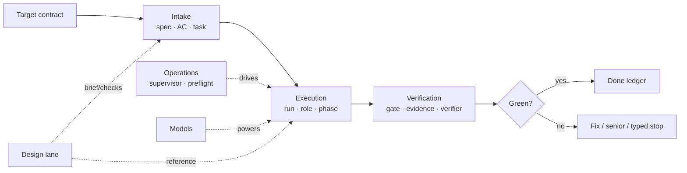
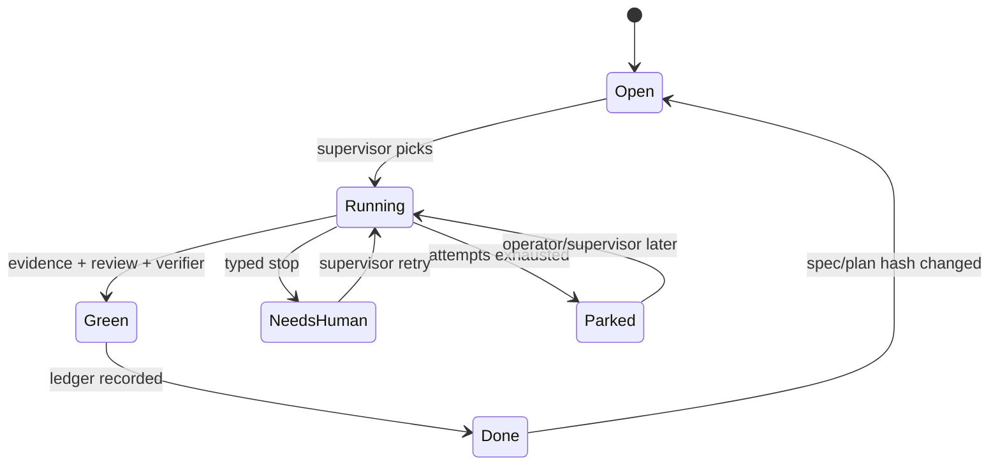
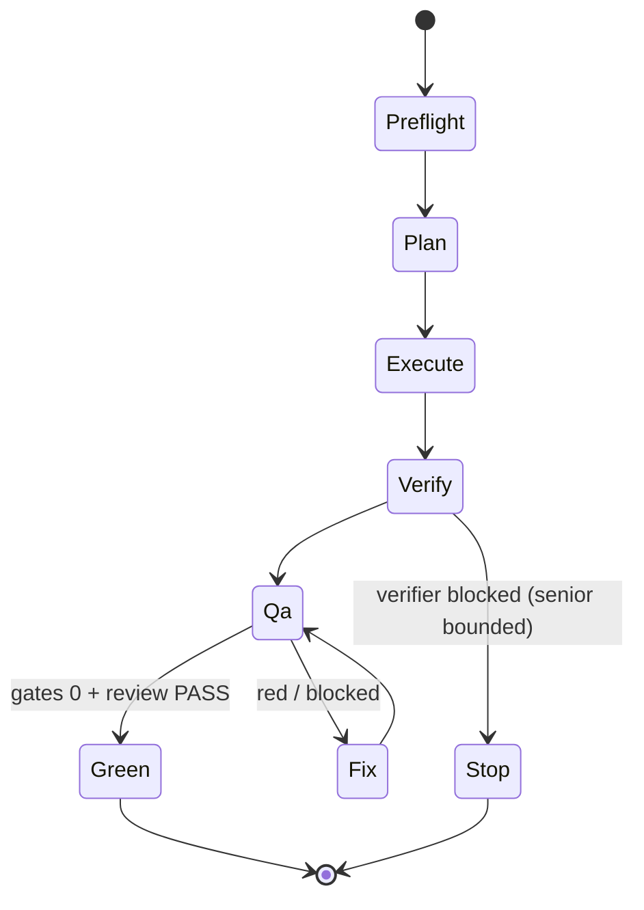
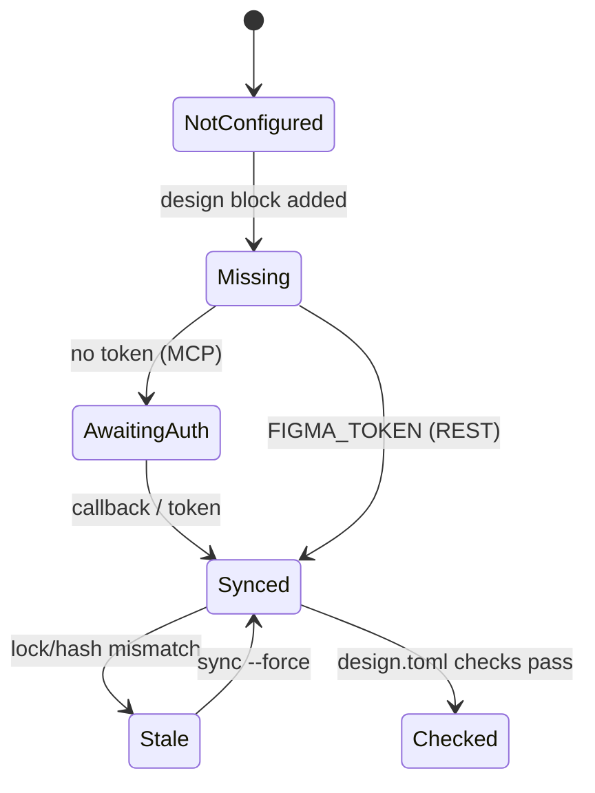

# Domain model — the factory

This is the model behind [`GLOSSARY.md`](../GLOSSARY.md). The glossary fixes the
**language**; this file fixes the **structure** — the contexts, aggregates,
invariants, lifecycles and boundaries. Decisions that were hard to reverse live
in [`docs/adr/`](adr/).

## Bounded contexts

| Context | Owns | Does not own |
| --- | --- | --- |
| **Intake** | target contract, specs, ACs, tasks, done ledger | code, gates |
| **Execution** | runs, roles, phases, fix rounds, senior escalation | evidence verdicts |
| **Verification** | gates, evidence, verifier, guards, acceptance, layout/design checks | implementation |
| **Operations** | supervisor, preflight, health, audit, report, parallel/stash/sandbox | scope decisions |
| **Models** | roles, model profiles, fallbacks, provider registry | what a model may write |
| **Design lane** | design cache, IR, brief, lock, transport, auth | product code |
| **Release** | package, tags, target pin | a target's tree |

## Aggregates

### Target contract

The root aggregate of a target: `root`, `specs_dir`, `scope`, `gates`,
`gate_map`, `e2e`, `drivers`, `design`, `risk`, `python`, `runs_dir`.

**Invariants**

- One contract per target; every consumer reads it, none hardcodes a target
  path.
- Unknown keys are tolerated (older factory, newer file); known keys with the
  wrong type are errors.
- A missing key falls back to the factory default, never a neighbouring tree.
- `drivers` and `design` are optional capabilities; absence means "packaged" or
  "no design lane", never a silent no-op.

### Spec

A folder with `spec.md`, `plan.md`, `tasks.md`, a `kind` (`product` or
`harness`), and optional `acceptance.toml`, `live.toml`, `layout.toml`,
`design.toml`.

**Invariants**

- A task maps to one or more ACs; an AC is verifiable or explicitly declared
  N/A in acceptance.
- Editing `spec.md`/`plan.md` changes the spec hash and reopens done tasks;
  ticking `tasks.md` does not.
- A harness spec is never queued by a target.

### Task

Identity: id, brief, AC refs. State: open or done (the ledger), plus the
supervisor's parked state.

**Invariants**

- The task hash covers id + brief + sorted AC refs; any edit invalidates a prior
  done entry.
- A fix task is a task; it has no special execution path.

### Run

One task execution. Identity: run directory + task.

Recorded state: status, delta, out-of-scope reverts, gates + transcript, review,
verifier, judges, fix/senior rounds, e2e, acceptance, usage/cost, visual, design,
done hashes, approval.

**Terminal statuses**

`green`, `needs_human`, `preflight_failed`, `config_error`, `budget_exhausted`,
`quota_exhausted`, `timeout`, `interrupted`, `killed`, `commit_failed`,
`push_failed`, `merge_failed`. **Resumable:** `awaiting_approval` (and a killed
run with a checkpoint).

**Invariants**

- **Green is evidence**: every required gate exit is 0 at the final delta, the
  reviewer passed, and the verifier did not block.
- A judge that cannot answer fails closed; model prose is never evidence.
- A run cannot save a delta outside scope; out-of-scope paths are reverted.
- A green commit carries a done-ledger entry with matching hashes.
- A typed stop records a reason code; a missing one is a defect.

### Evidence

The immutable set of gate exits + transcript + the delta they describe.

**Invariants**

- Evidence is bound to the final delta; a later edit makes it stale.
- An e2e claim needs a recorded Playwright execution at the current delta.
- QA produces evidence; the reviewer consumes it; the verifier adds a scenario
  verdict, not gate evidence.

### Acceptance report

Per built product spec: AC verdicts, checks, N/A declarations, global facts,
layout issues, design issues, oracle results, vision notes.

**Invariants**

- Every AC has a check or an explicit N/A; `--strict` fails otherwise.
- An N/A is a declaration, not an unverified AC.
- An always-passing check fails the spec under `--selftest`.
- Live-only ACs are verified by the live lane and declared as such.
- A covered-by AC names an existing e2e test; it is reported `E2E`, never as a
  selector pass.
- The report, the logged verdict and the exit code are computed after every
  evidence source (design, layout, covered-by) is known.
- The vision verdict is advisory and never flips a verdict.

### Done ledger

Commit trailers (`task`, `task hash`, `spec hash`, `run`) with a gitignored
fallback cache.

**Invariants**

- Hash mismatch means not done, whatever `tasks.md` says.
- The ledger is append-only for a given task/hash pair.
- A manual entry is visible (`manual`, `manual_reason`) and a release gate can
  refuse it; recorded-by-hand is not the same claim as swarm-green.

### Design snapshot

The cached design: IR, brief, tokens, renders, MCP tool results, lock; plus the
transport and auth state.

**Invariants**

- The run reads only the cache; Figma is contacted only by sync/auth.
- The cache is local and gitignored (never source); sync reconstructs it from
  the pinned file key/nodes, and the lock records the version.
- The cache is immutable during a run; only sync writes it.
- A lock mismatch is `design_stale`, never a silent re-fetch.
- Only allowlisted nodes enter a prompt.
- Tokens never enter prompts, run records or logs.

### Model profile

Role → primary model + fallback; provider registry; strict prefixes.

**Invariants**

- Every role has a model; every fallback is a model the provider can serve.
- Judgement roles (reviewer, verifier) need reasoning models.
- An unknown provider prefix is an error unless the legacy escape is set.
- Costs are numbers or explicitly unknown, never a fake zero.
- An e2e/visual task gets the 2× budget profile; the run records which profile
  and multiplier applied, so a cap stop is attributable.

## Lifecycles

### Task (queue → done)

### Run (one task)

### Design

### Acceptance verdict

`UNVERIFIED` (no check, no N/A) → `PASS` (every AC covered and green) or `FAIL`
(any failed check, global/layout/design issue, or always-passing oracle). N/A
does not make a spec FAIL; it makes an AC honestly out of scope.

## Events (the ones that matter)

`task_started`, `gate_recorded`, `review_verdict`, `verifier_verdict`,
`task_green`, `fix_queued`, `retry_later`, `escape_recorded`,
`acceptance_verdict`, `design_synced`, `figma_auth_required`.

Events are facts for the record and the dashboard; none of them grants green —
only the recorded evidence does.

## Boundaries and anti-corruption

- **Product vs harness specs.** A product spec describes the target's behaviour;
  a harness spec describes the factory. They share the file format but never the
  queue.
- **Target-owned drivers.** A driver is a command with a JSON result; the
  packaged fallback is not a second behaviour, it is the same phase.
- **Providers as data.** A provider is a registry row, not a branch in the flow.
- **Design IR is source-agnostic.** MCP and REST produce the same cache shape;
  the checks and prompts never know the transport.
- **The target contract is the only path source.** The factory names concepts,
  not `../app` paths.

## Code and docs map

| Concept | Where it lives |
| --- | --- |
| target contract | `src/swarm/contract.py`, `swarm.yaml.example`, `docs/install.md` |
| specs/tasks | `src/swarm/spec_loader.py`, `docs/queue.md` |
| run/flow | `src/swarm/flow.py`, `docs/running.md` |
| gates/evidence | `src/swarm/gates.py`, `docs/tools-and-gates.md` |
| verifier | `src/swarm/verify.py`, `docs/verifier.md` |
| guards | `src/swarm/guards.py`, `docs/run-guards.md` |
| done ledger | `src/swarm/done.py`, `docs/commits.md` |
| supervisor | `src/swarm/supervise.py`, `docs/unattended.md` |
| drivers | `src/swarm/drivers/dispatch.py`, `docs/drivers.md` |
| acceptance | `src/swarm/drivers/acceptance.py`, `docs/testing.md` |
| layout | `src/swarm/layout.py` |
| design | `src/swarm/design/`, `docs/design.md` |
| models/providers | `src/swarm/model_config.py`, `src/swarm/providers.py`, `docs/providers.md` |
| risk | `src/swarm/risk.py`, `docs/risk-classes.md` |
| bench/replay | `src/swarm/drivers/bench/`, `docs/testing.md` |
| parallel/stash/sandbox | `docs/parallel.md`, `docs/commits.md`, `docs/unattended.md` |
| audit | `src/swarm/factory_audit.py` |
| CLI | `src/swarm/cli.py`, `docs/install.md` |

## Ambiguities this model resolves

| Overloaded term | Canonical use |
| --- | --- |
| run / pilot | **run** = one task; **pilot** = the foreground queue process |
| green / done | **green** = evidence-backed merge; **done** = valid ledger entry |
| QA / reviewer | **QA runs gates**; the **reviewer judges evidence** |
| gate / test | a **gate** is any exit-code check; a test is one kind |
| acceptance / e2e | **acceptance** is per-spec; **e2e** is per-task gate evidence |
| driver / script | a **driver** speaks the JSON protocol; a script need not |
| design check / visual phase | **design check** is deterministic; **visual** is advisory |
| design cache / lock | **cache** is the snapshot; **lock** proves it is current |
| live-only / N/A | **live-only** has a live check; **N/A** has no browser surface |
| spec kind | **product** is queued; **harness** improves the factory |
