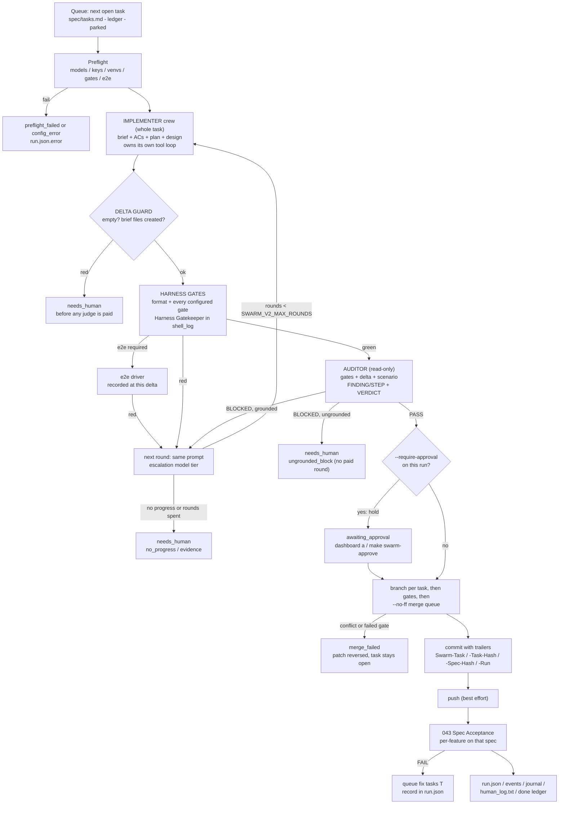

# How the swarm organizes the work

> Part of the swarm harness documentation. Start at [`../README.md`](../README.md).

## How the swarm organizes the work

One task at a time: a `- [ ] T<n>` line from `specs/*/tasks.md` that the done
ledger does not already hold. Each phase is a small CrewAI crew with its own
model role; a CrewAI Flow (`src/swarm/flow.py`) sequences them and owns every
decision that must not be made by a model (retries, scope, green, commit).

### Roles

| Role | Model env | Job | Can make a run green? |
| --- | --- | --- | --- |
| Implementer | `SWARM_IMPLEMENTER_MODEL`, else `SWARM_CODER_MODEL` | Owns the whole task: reads the spec/plan/real modules, plans inside its tool loop, writes every file the brief names. Runs no gates. | no |
| Implementer (escalation) | `SWARM_ESCALATION_MODEL`, else `SWARM_SENIOR_MODEL` | The same builder and prompt after a rejected round, fed the gate transcript or audit findings. | no |
| Auditor | `SWARM_AUDITOR_MODEL`, else `SWARM_VERIFIER_MODEL` / `SWARM_REVIEWER_MODEL` / `SWARM_SENIOR_MODEL` | Read-only: judges the recorded gate evidence, the delta and the scenario; returns grounded `FINDING:`/`STEP:` lines and `VERDICT: PASS/BLOCKED`. | **yes**, with green deterministic gates |
| Harness (`Harness Gatekeeper`) | no model | Runs every configured gate, the e2e driver, scope/delta checks, formatting and the commit; records argv/exit/output in `shell_log.jsonl`. | **yes** (the evidence) |
| Conflict / stash resolver | implementer model | Resolves a merge or stash conflict inside the task's scope. | no (gates decide) |
| Visual QA / acceptance vision | `SWARM_VISUAL_MODEL` | Advisory screenshots/DOM facts after green; never flips a verdict. | no |

**Legacy (v1 rollback, `SWARM_FLOW_V2=0`).** Planner, micro-step coder,
self-check, verifier, correction crews, QA gatekeeper, reviewer, senior fix.
v2 never calls them; their code and ids remain for one release so the pilot can
A/B and roll back. ADR 0005 records the decision.

### The sequence (v2, default)

1. **Preflight** — models, keys, venvs, gate binaries, Playwright browsers, the
   crews' real role factories. Fail before the first LLM call.
2. **Implement** — one implementer crew receives the whole task: brief,
   referenced AC paragraphs, plan lines, design brief, scope and the test-first
   expectation. It plans inside its own tool loop; there is no planner call and
   no micro-step.
3. **Delta guard** — model-free: empty delta → `no_delta`; a brief-named file
   never created → `delta_incomplete`. Stop before any judge is paid.
4. **Deterministic gates** — the harness formats, then runs every configured
   gate as `Harness Gatekeeper`, recording argv/exit/output in
   `shell_log.jsonl`. A missing or stale record is red, not prose. A required
   browser spec runs through the e2e driver before the audit.
5. **Audit** — when every gate is green, one read-only auditor judges the gate
   transcript, the full delta and the scenario context. It returns grounded
   `FINDING:`/`STEP:` lines and `VERDICT: PASS/BLOCKED`.
6. **Round loop** — a red gate/e2e round or a grounded block becomes the next
   implementer round's feedback. Round 2+ runs the same prompt on the escalation
   model tier. Stop at `SWARM_V2_MAX_ROUNDS` (default 3), on no progress, on an
   ungrounded block, or on any typed budget/wall stop.
7. **Green gate** — only when every gate exits 0 at the final delta, the auditor
   says `PASS`, e2e evidence exists when the brief names `frontend/e2e/*`, and
   the run was not started with `--require-approval` (the one hold that exists).
   `save_run` re-runs the evidence check. Then: branch per task → gates →
   `--no-ff` merge queue → commit with trailers (`Swarm-Task`, `-Task-Hash`,
   `-Spec-Hash`, `-Run`) → push → **043 Spec Acceptance pass** runs on that spec
   (automatic, per-feature). Failing ACs queue one `T<n>` fix task each (deduped
   against open `acceptance`-tasks) and record the verdict in `run.json`. The
   task is still recorded green in the done ledger; the acceptance result is
   stored alongside. Green-but-unconfirmed (a selected subset only) is
   `needs_human`.
8. **Record** — `run.json` (including `flow.version`, the implementer rounds and
   the auditor verdicts), `events.jsonl`, `shell_log.jsonl`, `progress.json`, the
   journal, `human_log.txt`, the done ledger.

`SWARM_FLOW_V2=0` runs the v1 sequence (planner → micro-steps → self-check →
verifier → QA → fix rounds → senior); it remains for the pilot's rollback.

### Flow

`SWARM_FLOW_V2=0` replaces the implementer/gates/auditor block with the v1
planner → micro-steps → verifier → QA → fix sequence.

### The invariant that shapes everything

- **Green is evidence, not the model's prose.** Gate exit codes come from
  `shell_log.jsonl`; v2 records them under `Harness Gatekeeper`, and v1 under
  `QA Gatekeeper`. The auditor/verifier reads them and never produces gate
  evidence.
- **Deterministic guards sit around the judges, not inside them.** They stop
  with typed reason codes (`no_delta`, `delta_incomplete`, `ungrounded_block`,
  `e2e_missing`, `quota_exhausted`, `wall_budget`) and none of them can make a
  run green.
- **One retry authority.** The harness retries, falls back and backs off; agents
  retry zero times (`max_retry_limit=0`).
- Several independent tasks can run at once via `make swarm-parallel` (detached
  worktrees, `--no-commit`), but integration is serial with the main tree as the
  single writer.
